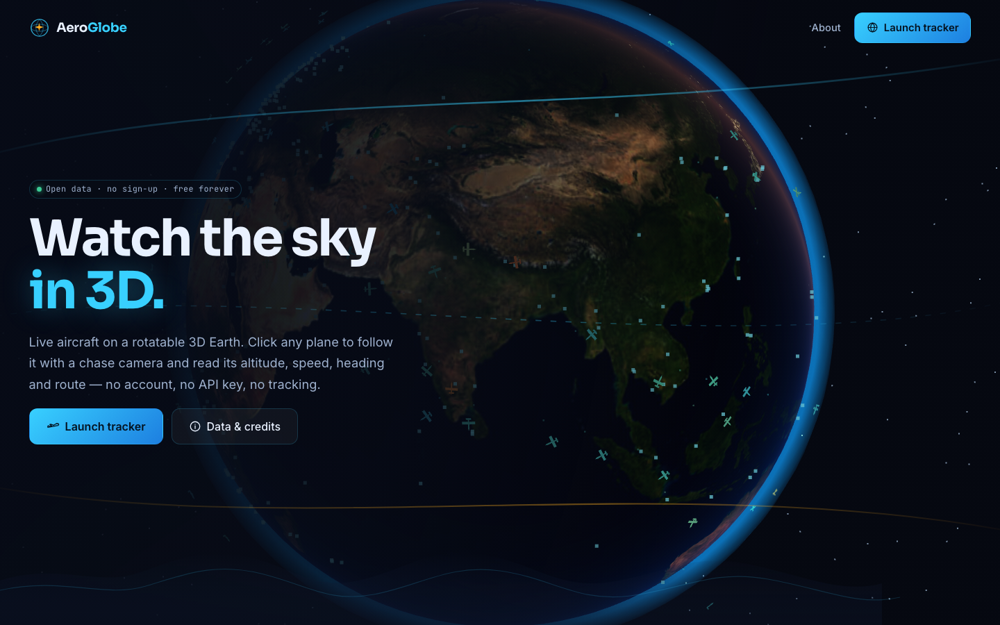
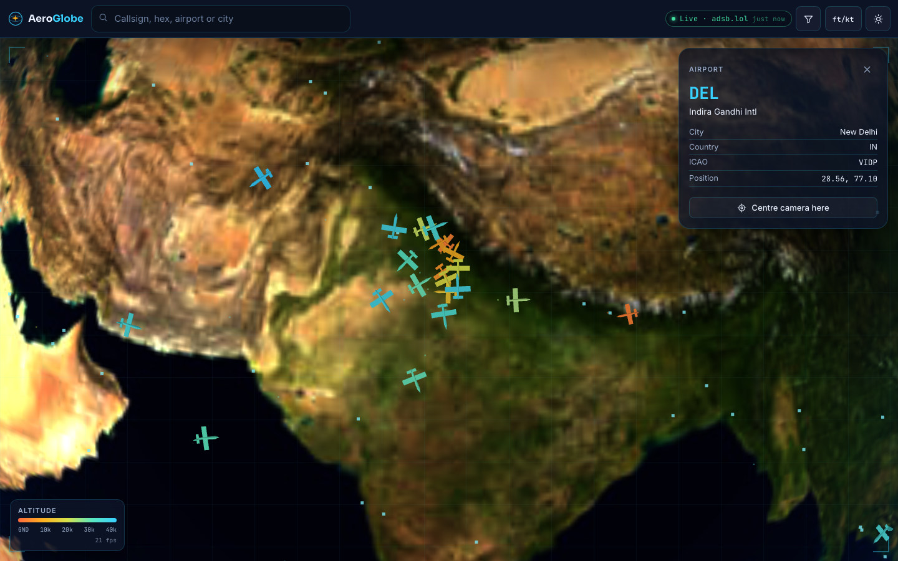
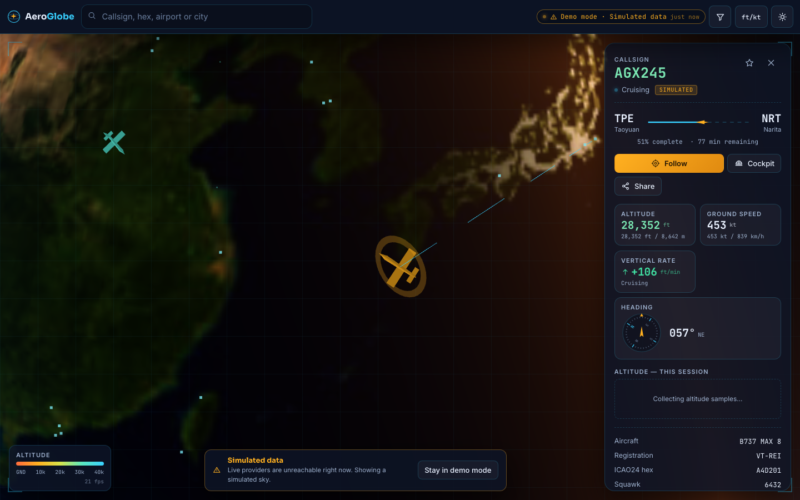
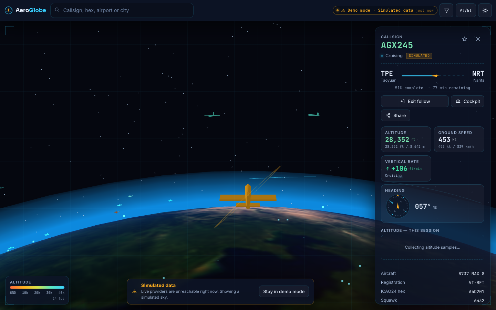
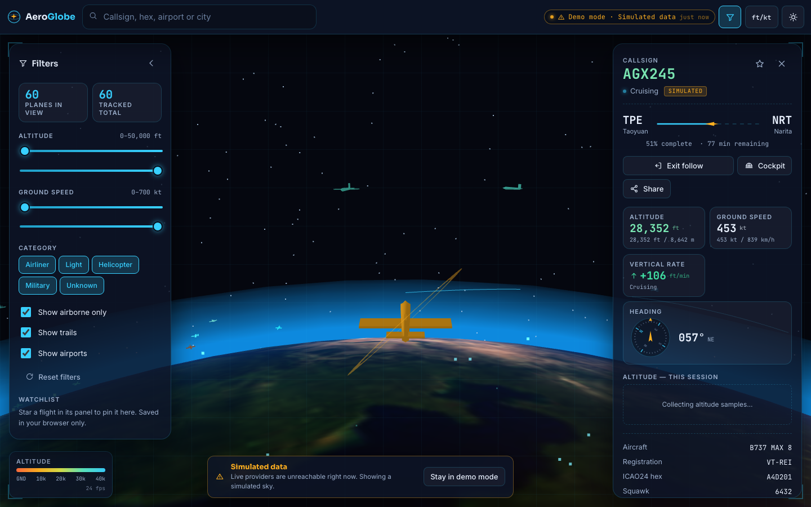
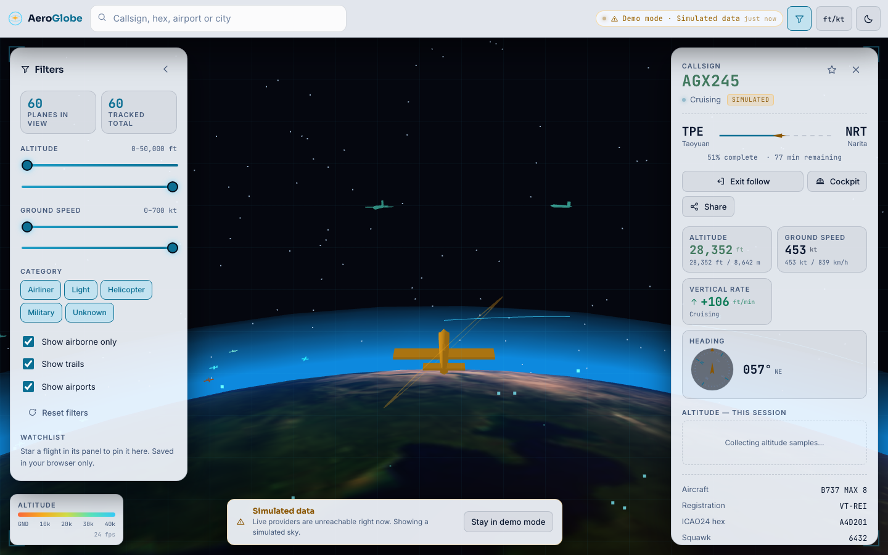
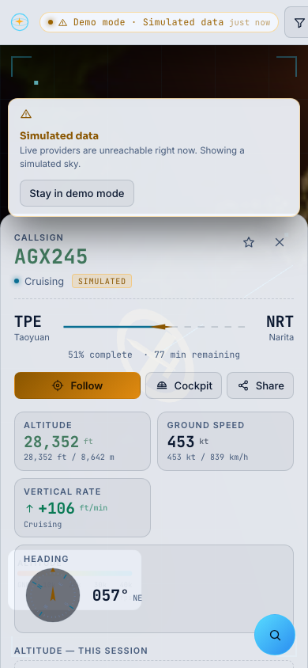

# AeroGlobe

**Watch the sky in 3D.**

A free, no-sign-up 3D flight tracker. Live aircraft fly over a rotatable 3D Earth built with
Three.js — click any plane to follow it with a chase camera and read its altitude, speed,
heading and route in a cockpit-style panel.

AeroGlobe is an independent open-source demo inspired by the general idea of flight
tracking. It is **not affiliated with, endorsed by, or derived from any flight-tracking
company**. All names, branding, copy, icons and illustrations are original work created for
this project.

## Live demo

- **Live site:** https://aeroglobe.vercel.app _(updated after deployment)_
- **Repository:** https://github.com/DIVYAPRIYADHARSHINI-GIT/aeroglobe



## Screenshots

| | |
| --- | --- |
|  |  |
| Live ADS-B traffic over India, coloured by altitude | Boarding-pass flight panel with live tiles |
|  |  |
| Chase camera riding behind the selected aircraft | Filters, watchlist and nearby airports |
|  |  |
| Light panel theme (the globe stays dark) | Mobile bottom sheet + floating search |

## Purpose

Show what is possible on a completely free stack: free hosting (Vercel Hobby), free open
data, **no API keys, no accounts, no paid services, and no tracking**. Everything the app
remembers about you lives in your own browser's localStorage.

## Features

### 3D view
- Interactive Three.js globe with a public-domain NASA Earth texture, soft atmosphere glow
  and a procedural star field. No map-tile servers, no tokens.
- **Day/night shading** computed from the real sun position, with city lights glowing on the
  night side and warm scatter at the terminator. Updates continuously.
- Aircraft as low-poly 3D airplanes built from Three.js primitives, rotated to true heading
  and pitched by vertical rate.
- **Altitude-aware:** planes float on a visible shell above the surface (real cruise altitude
  is ~0.17% of Earth's radius and would be invisible), each with a ground-track dot and an
  altitude colour scale (warm = low, cool = high) plus a legend.
- **Flight trails:** a short fading trail behind every plane, plus a longer trail and a dashed
  great-circle route to the destination for the selected aircraft.
- Drag to rotate, scroll/pinch to zoom, smooth camera easing, and arrow-key/+/- controls.
- **Follow camera** (chase view behind and above), a **cockpit view** toggle, and "Exit follow".
- ~380 airports as glowing markers from bundled open data; click one for an info card and to
  fly the camera there.

### Flight panel
- Boarding-pass card: callsign, origin/destination with a progress bar and plane icon,
  aircraft type, registration, ICAO24 hex and squawk.
- Live tiles: altitude (ft **and** m), ground speed (kt **and** km/h), vertical rate with an
  up/down arrow, heading with a rotating compass dial, and an altitude-over-time SVG graph
  built from points collected during this session.
- Metric / aviation unit switcher, saved in settings.
- **Share** button that copies a link opening the app focused on that aircraft.
- Right-hand panel on desktop, bottom sheet on mobile.

### Search & filters
- Instant search by callsign, ICAO24 hex, airport code or city, with keyboard-navigable
  suggestions.
- Filters: altitude range, speed range, aircraft category (airliner / light / heli /
  military when flagged), "airborne only", "show trails", "show airports".
- **Watchlist:** star flights (saved in localStorage) and fly the camera to each one.
- "Planes in view" / "tracked total" counters and a "busiest airports nearby" list.

### Design & accessibility
- Deep night-sky navy (`#070B16`), cyan accent (`#38D0FF`), amber for selection/warnings
  (`#FFB020`); glass-morphism panels, HUD grid and corner brackets.
- Sora (headings), Inter (body), JetBrains Mono (callsigns, numbers, codes).
- Custom SVG icons only — **no emoji anywhere in the UI**.
- Light panel theme with re-tokenised accents that meet **WCAG AA contrast** (verified
  automatically in the test suite); the globe stays dark.
- Loading ("Contacting satellites…"), empty, error and offline states, plus a clear
  **"WebGL not supported"** fallback.
- Responsive from 360px up, 44px tap targets, aria labels, keyboard-friendly controls, skip
  link, and `prefers-reduced-motion` support.

### Pages
| Route | Purpose |
| --- | --- |
| `/` | Landing page: live auto-rotating globe hero, feature cards, how-it-works |
| `/track` | The 3D tracker |
| `/about` | Data sources, credits, limitations, privacy |
| `/flight/[id]` | Deep link that opens `/track` focused on that aircraft |

## Tech stack

- **SvelteKit 3** + **Svelte 5** (runes) + **TypeScript**
- **Three.js** for all 3D (custom shaders for day/night and atmosphere)
- `@sveltejs/adapter-vercel` (Node 22 serverless)
- **No database**, no auth, no API keys. localStorage for watchlist and settings.
- Server routes only for the optional ADS-B proxy and its short-term cache.
- **Vitest** for unit tests, **Puppeteer** (driving your installed Chrome) for e2e.

## Data sources and their terms

Live positions come from volunteer-run ADS-B networks and the OpenSky Network's anonymous
public API. AeroGlobe tries each in order and uses the first that answers.

| Provider | Access | Notes |
| --- | --- | --- |
| [adsb.lol](https://api.adsb.lol/docs) | Free, no key | Community aggregator, region queries |
| [adsb.fi](https://github.com/adsbfi/opendata) | Free, no key | Open community feed |
| [airplanes.live](https://airplanes.live/api-guide/) | Free, registration requested | Its public endpoint currently returns a "contact us" error, so the chain skips it automatically |
| [OpenSky Network](https://openskynetwork.github.io/opensky-api/) | Free, anonymous | Rate-limited; **non-commercial / research use** |

**Attribution (required).** Every page carries:

> Live positions from community ADS-B networks and OpenSky Network. Open data, attribution
> required.

**Rate limits and good-citizen behaviour.** AeroGlobe:
- queries **only the region around the camera** (radius hard-capped at 250 NM), never the
  whole world;
- polls every **10–15 seconds** with jitter;
- **pauses polling entirely when the browser tab is hidden**;
- **backs off exponentially** after consecutive errors (up to 2 minutes);
- caches proxy responses for a few seconds, server-side and at the edge;
- sends an identifying `User-Agent` on proxied requests.

**Other open data**
- Airports: [OurAirports](https://ourairports.com/data/) — public domain. Bundled into the
  app, so airport search and markers work offline.
- Earth textures: NASA [Blue Marble](https://visibleearth.nasa.gov/) and Earth at Night —
  NASA imagery is generally not copyrighted. Stored in `static/textures/`.

### CORS and the proxy
None of the four endpoints currently send an `Access-Control-Allow-Origin` header, so a
browser-direct fetch always fails CORS. The chain therefore goes straight to AeroGlobe's own
`/api/adsb` route, which relays the region query and caches the response. The
browser-direct path is still implemented — flip `corsFriendly: true` in
`src/lib/providers/sources.ts` if a feed starts allowing it.

### Provider fallback chain
```
adsb.lol → adsb.fi → airplanes.live → OpenSky → SIMULATED DEMO MODE
   (each: browser-direct if CORS-friendly, then /api/adsb proxy)
```
Failures are silent; only the status chip changes (`Live · adsb.lol` / `Demo mode ·
Simulated data`).

### Demo mode
If no live provider answers within **5 seconds**, AeroGlobe falls back to a simulated sky:
~60 generated aircraft flying real great-circle routes between real airports (India, Europe,
the US, East Asia, the Middle East, Oceania, South America) with realistic climb, cruise and
descent profiles. It is always labelled **"Simulated data"** in the status chip, the flight
panel and an on-screen banner, so it can never be mistaken for real traffic. Demo carrier
names and callsigns are **fictional inventions** for this project.

Between data updates, every aircraft is **dead-reckoned** from its last position, speed,
heading and vertical rate, so planes glide continuously instead of jumping.

## Setup

Requires Node 20+ (built and tested on Node 26).

```bash
git clone https://github.com/DIVYAPRIYADHARSHINI-GIT/aeroglobe.git
cd aeroglobe
npm install
npm run dev        # http://localhost:5173
```

Other scripts:

```bash
npm run build      # production build
npm run preview    # serve the production build on :4173
npm run check      # svelte-check / TypeScript
npm test           # unit tests (vitest)
npm run test:e2e   # headless end-to-end suite (needs `npm run preview` running)
```

There are **no environment variables** and no `.env.example`: the app works with zero
configuration. Nothing needs a key or an account.

Regenerating the bundled airport list (optional):
```bash
curl -sL -o /tmp/airports.csv https://davidmegginson.github.io/ourairports-data/airports.csv
node scripts/build-airports.mjs
```

## Testing

- **36 unit tests** (`tests/geo.test.ts`): geodesy against known distances, provider
  normalisation for both upstream payload shapes, region/radius clamping, demo-fleet
  validity and motion, the airport dataset, and WCAG contrast maths.
- **104 end-to-end checks** (`tests/e2e.mjs`) in headless Chrome, covering the full flow —
  landing → launch tracker → globe loads → live or demo data → select a plane → follow
  camera → cockpit → flight panel → search → filters → watchlist → share link — plus:
  - **live providers blocked** → verified fallback to demo mode (~1 s)
  - desktop, mobile (390px and 360px) and light/dark panels
  - WCAG AA contrast on light panels, and panel/banner/legend overlap
  - WebGL-missing fallback
  - API citizenship: region-scoped URLs, no keys, 250 NM cap, polling paused while hidden
  - proxy behaviour and cache headers
  - accessibility: accessible names, tap-target sizes, aria-live, keyboard controls, no emoji
  - frame rate (software WebGL in CI; ~60 fps on a real GPU)

All suites pass with **0 TypeScript errors and 0 svelte-check warnings**.

## Performance notes

- Aircraft, ground dots, trails and airports are **instanced / buffered** — one draw call each.
- The rendered aircraft count is **capped at 400**, sorted by camera distance, with the
  selected aircraft always retained.
- Positions are advanced inside the render loop, **outside Svelte reactivity**, so a busy sky
  cannot trigger a reactive loop or freeze the page. Panel numbers are throttled to ~4 Hz.
- Trails rebuild on a 500 ms throttle, not per frame.
- `dispose()` tears down every geometry, material, texture and listener.

## Known limitations

- **Not for navigation.** Never use AeroGlobe operationally or for any safety decision.
- **Coverage is volunteer-driven.** Aircraft appear only where a community receiver can hear
  them; oceans, deserts and parts of the southern hemisphere are sparse.
- **Positions between updates are estimates** (dead reckoning).
- **Altitude is exaggerated** so aircraft are visible above the globe.
- **Origin/destination are usually unknown** for live flights — community ADS-B carries
  position and identity, not schedules. Route lines and progress bars appear for demo
  flights, and for live flights only when the feed supplies them.
- **Military flagging is feed-dependent**; many state aircraft are not marked.
- Anonymous OpenSky is rate-limited and intended for non-commercial use.
- The optional 2D/3D flat-map toggle was scoped out as a nice-to-have.

## Privacy

No accounts, no login, no email. No analytics, no ads, no third-party tracking scripts.
Watchlist, units, panel theme and filters are stored in your browser's localStorage and are
never sent anywhere. The only server-side code is the ADS-B proxy, which caches public
aircraft data for a few seconds and stores nothing about you.

## Project layout

```
src/
  lib/
    components/     # Icon, GlobeCanvas, FlightPanel, FilterPanel, SearchBox, ...
    data/airports.ts        # generated from OurAirports (public domain)
    providers/      # sources, normalise, client (fallback chain), demo simulator
    state/          # traffic + settings stores (Svelte 5 runes)
    three/          # globe engine and 3D helpers
    geo.ts format.ts search.ts types.ts
  routes/
    +page.svelte            # landing
    track/                  # the 3D tracker
    about/                  # data sources, limitations, privacy
    flight/[id]/            # deep link -> /track#id
    api/adsb/+server.ts     # optional ADS-B proxy + cache
static/textures/            # NASA Earth day/night imagery
scripts/build-airports.mjs  # regenerates the airport dataset
tests/                      # unit tests + e2e suite
```

## License

Code is released for free use as a demo. Flight data belongs to its respective networks and
is subject to their terms (open data, attribution required, OpenSky anonymous access is
non-commercial). NASA imagery and OurAirports data are public domain.
